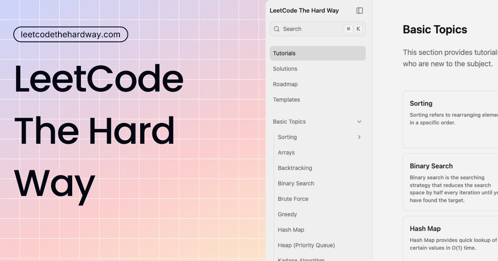

[LeetCode](https://leetcode.com/) is a platform that offers a collection of coding problems and challenges that are designed to help developers improve their skills in data structures and algorithms. Initially, this project was created for my own personal education, however now it is publicly available and open for anyone to use.

Contributions are welcome. Please see [CONTRIBUTING.md](CONTRIBUTING.md).

Discord Community: https://discord.com/invite/Nqm4jJcyBf

## **Website & Autofill Extension**

Explore Zapply’s website and check out:
- Our Chrome extension, which autofills job applications in seconds.
- A dedicated job board featuring the latest openings across various roles.
- User accounts with multiple profiles for different resume types and roles.
- Job application tracking with streaks and commitment awards.
Experience an advanced career journey with us! 🚀

 

Sponsored by Zapply

## License

This project is licensed under the [MIT License](LICENSE).
