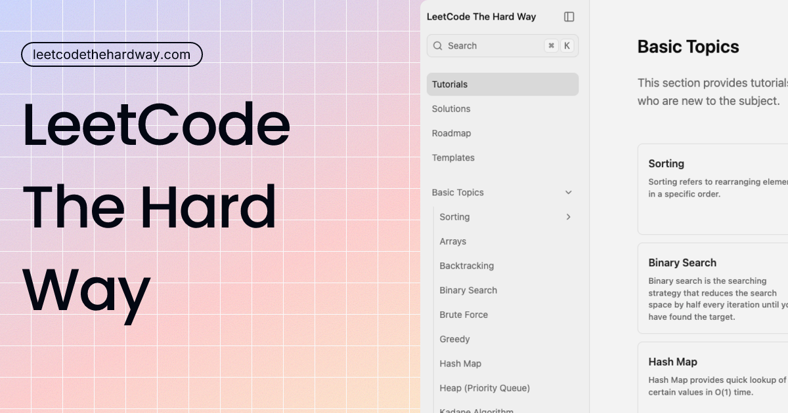

[LeetCode](https://leetcode.com/) is a platform that offers a collection of coding problems and challenges that are designed to help developers improve their skills in data structures and algorithms. Initially, this project was created for my own personal education, however now it is publicly available and open for anyone to use.

Contributions are welcome. Please see [CONTRIBUTING.md](CONTRIBUTING.md).

Discord Community: https://discord.com/invite/Nqm4jJcyBf

## License

This project is licensed under the [MIT License](LICENSE).
